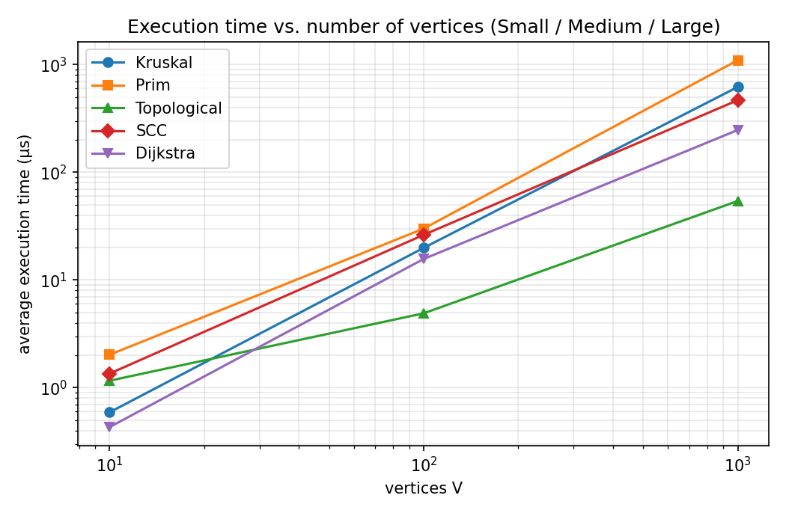
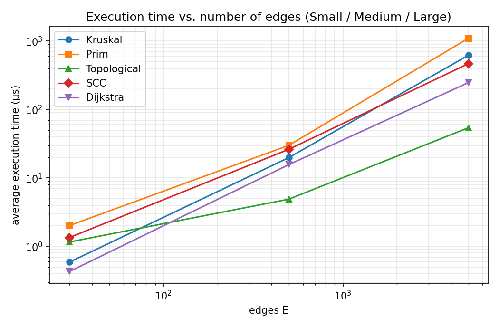
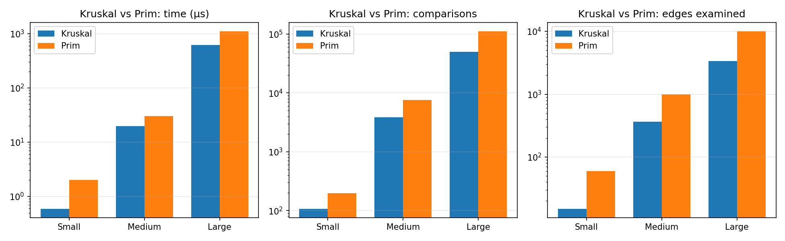
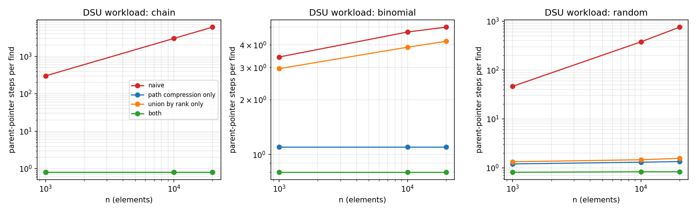
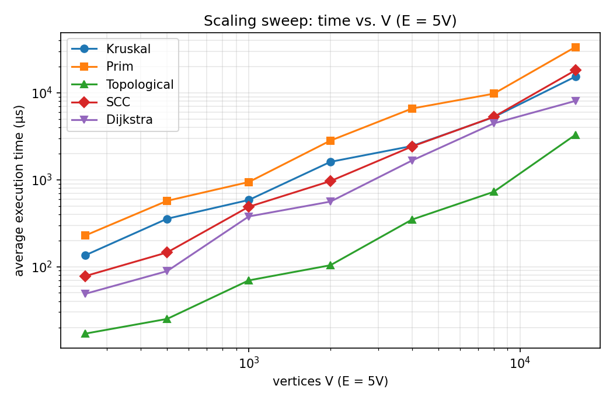
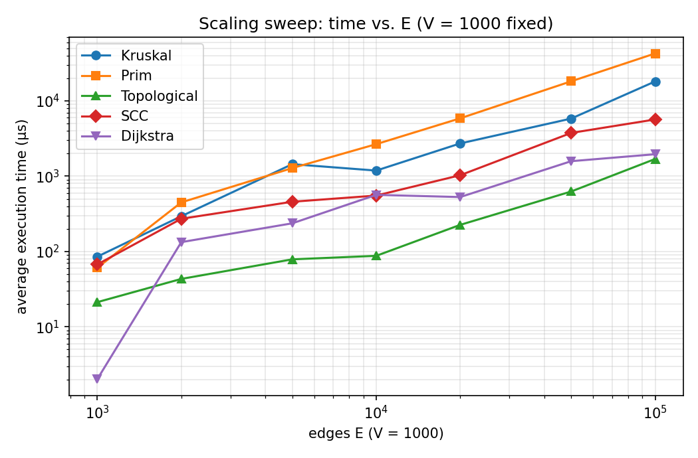

# Assignment 3 — Smart City Infrastructure Network (Java)

A Java application that models a city as a weighted graph and implements, tests and benchmarks the graph algorithms a city planner needs:

| Task | Question for the planner | Algorithms |
|---|---|---|
| 1 | What is the cheapest road network that connects every district? | Kruskal (with DSU), Prim (binary heap) |
| 2 | Which services depend on each other? Is there a circular dependency? | Topological sort (Kahn), Strongly Connected Components (Kosaraju) |
| 3 | What is the shortest route from a district to every other one? | Dijkstra (binary heap) |

Everything is plain Java (no external libraries); tests use a small built-in runner, so the project builds with just a JDK.

## Contents

1. [Overview](#1-overview) · 2. [Implementation](#2-implementation) · 3. [Complexity Analysis](#3-complexity-analysis) · 4. [Experimental Setup](#4-experimental-setup) · 5. [Results](#5-results) · 6. [Comparison and Discussion](#6-comparison-and-discussion) · 7. [Testing](#7-testing) · 8. [Conclusion](#8-conclusion) · [How to build and run](#how-to-build-and-run)

## Repository layout

```
assignment-3/
├── src/
│   ├── graph/          Graph, Edge, Metrics (operation counters), GraphGenerator (seeded)
│   ├── dsu/            DSU (find/union, path compression, union by rank, switchable)
│   ├── mst/            Kruskal, Prim, MSTResult
│   ├── connectivity/   TopologicalSort (Kahn), StronglyConnectedComponents (Kosaraju)
│   ├── shortestpath/   Dijkstra
│   ├── experiments/    Benchmark (all experiments -> results/tables)
│   ├── tests/          TestRunner (116 checks, no JUnit needed)
│   └── app/            CityDemo (end-to-end example with named districts)
├── scripts/plot.py     Reads results/tables/*.csv, writes results/plots/*.png
├── results/
│   ├── tables/         CSV + Markdown tables written by the benchmark
│   ├── plots/          PNG plots
│   ├── benchmark_log.txt, test_output.txt, demo_output.txt
├── build.sh, run_all.sh
└── README.md           (this report)
```

---

## 1. Overview

**Model.** A city is a graph: vertices `0..V-1` are districts; edges are roads or infrastructure links; the integer weight is a construction cost (Task 1) or a distance (Task 3). Task 1 uses an **undirected** graph; Tasks 2 and 3 use **directed** graphs (one-way roads, service dependencies).

**Representation.** `Graph` stores an **adjacency list** (`List<List<Edge>>`, used by Prim, Kahn, Kosaraju, Dijkstra) *and* a flat **edge list** (used by Kruskal, which must sort all edges). An undirected edge is stored once in the edge list and twice in the adjacency lists. Memory is `O(V + E)`; iterating the neighbours of `u` costs `O(deg(u))`. An adjacency list is the right choice because all test graphs are sparse (`E = 3V … 5V`, far below `V²`).

**Operation counting.** Every algorithm fills a `Metrics` object (edges examined, comparisons, DSU finds/unions, parent-pointer steps, heap pushes/pops, relaxations), so results can be compared by *work done* as well as wall-clock time.

**Demo.** `java -cp out app.CityDemo` runs all three tasks on a 7-district city (output in `results/demo_output.txt`). For example Kruskal and Prim both find a network of total cost 39, a circular service dependency (Airport → Downtown) is detected and the six districts involved are reported as one SCC, and unreachable districts are reported as such by Dijkstra.

## 2. Implementation

### DSU (`dsu/DSU.java`)
* `find(x)` is **iterative and two-pass**: pass 1 walks to the root; pass 2 (path compression) re-points every node on the path directly at the root. No recursion, so a 200 000-long chain cannot overflow the stack.
* `union(a, b)` finds both roots, returns `false` if they are equal (this is how Kruskal detects a cycle), otherwise attaches the root of **lower rank** below the other (union by rank) and maintains the number of components.
* Both optimisations are **switchable** through the constructor, only so the experiments can measure each one in isolation. The algorithms always use the default (both on).
* Counters: `findCalls`, `unionCalls`, `pointerSteps` (number of parent hops).

### Kruskal (`mst/Kruskal.java`)
Copies the edge list, sorts it by weight with a comparator that counts comparisons, then scans it with a DSU. It **stops as soon as `V-1` edges are chosen** (the remaining edges cannot be useful), which is why it often examines fewer than `E` edges. For a disconnected graph the loop finishes without reaching `V-1` edges, the DSU reports more than one component, and the result is flagged `connected = false` — the returned edges then form a minimum spanning *forest*.

### Prim (`mst/Prim.java`)
Binary-heap (`PriorityQueue`) implementation with **lazy deletion**: when a vertex joins the tree, all edges to non-tree vertices are pushed; when an edge is popped whose far end is already in the tree it is simply skipped. If the queue empties before all vertices are visited, Prim **restarts from the next unvisited vertex** and counts one more component, giving the same minimum spanning forest as Kruskal and the same connectivity verdict.

### Topological ordering (`connectivity/TopologicalSort.java`)
Kahn's algorithm: compute in-degrees, repeatedly output a vertex of in-degree 0 and decrement its successors. If fewer than `V` vertices were output, the graph contains a cycle: the result says `acyclic = false`, returns no complete order, and lists the **blocked vertices** (those on, or reachable only through, a cycle). `isValidOrder` independently verifies an order (permutation + every edge goes forward) and is used in the tests.

### SCC (`connectivity/StronglyConnectedComponents.java`)
Kosaraju: DFS on `G` to record finishing order, then DFS on the transpose graph in decreasing finishing order; each tree of the second pass is one SCC. Both DFS passes are **iterative** (explicit stack + per-vertex "next neighbour" index). Result: list of components (vertices sorted), `componentOf[v]`, count and size of the largest SCC.

### Dijkstra (`shortestpath/Dijkstra.java`)
Binary-heap with lazy deletion and a `settled[]` array (every vertex is expanded once). Returns `dist[]` (`Long.MAX_VALUE` = unreachable), `prev[]` for **path reconstruction**, `reachable(v)`, `reachableCount()` and `pathTo(v)` (empty list when unreachable). `run()` **throws `IllegalArgumentException` on any negative weight**; `runUnchecked()` exists only to demonstrate the failure (below).

**Why Dijkstra fails with negative edges.** Dijkstra relies on the invariant *"the vertex with the smallest tentative distance can no longer be improved"*: any other route to it must pass through a vertex that is at least as far away, and adding non-negative edges can only make it longer. A negative edge breaks this: a vertex that was already settled can later be reached more cheaply through a vertex settled after it, but it is never expanded again, so the error propagates to its successors. Counter-example (`s→a:1, s→b:2, b→a:−2, a→c:1`): Dijkstra settles `a` at distance 1 and then sets `c = 2`; the true shortest path `s→b→a→c` costs `2 − 2 + 1 = 1`. This exact graph is a test: `runUnchecked` returns 2, Bellman–Ford returns 1. Suitable alternatives are Bellman–Ford `O(V·E)` (also detects negative cycles) or Johnson's re-weighting; with a negative *cycle* shortest paths are not even defined.

### Graph generation (`graph/GraphGenerator.java`)
All generators use `java.util.Random` with an explicit seed, never create self-loops or parallel edges, and draw integer weights uniformly from `[1, 100]`.

| Generator | Method | Cycles? |
|---|---|---|
| `connectedUndirected(V,E)` | random permutation → random spanning tree (each vertex joins a random earlier one) → add random distinct extra edges until exactly `E` | undirected cycles yes; **always connected** by construction |
| `directedDag(V,E)` | hidden random vertex order; each edge goes from an earlier to a later vertex | **never** (acyclic by construction) |
| `directedRandom(V,E)` | `E` distinct uniformly random ordered pairs | **yes** — verified by the experiments: SCCs of size 10/10, 99/100 and 989/1000 (Small/Medium/Large), and Kahn's algorithm fails on all three |

## 3. Complexity Analysis

**Assumptions.** Adjacency-list graph; `V` vertices, `E` edges; binary heap (`java.util.PriorityQueue`, `O(log n)` push/pop, no decrease-key, hence lazy deletion); comparison-based sort for Kruskal; `α` is the inverse Ackermann function (`α(n) ≤ 4` for any practical `n`); "space" counts auxiliary memory beyond the input graph.

| Algorithm | Time | Space | Depends on V / E how? |
|---|---|---|---|
| **DSU** `find` / `union` (both optimisations) | `O(α(n))` amortised per operation; `m` operations on `n` elements: `O(m·α(n))` | `O(n)` | Independent of `E`; grows only with the number of elements `n`, and so slowly it is effectively constant |
| DSU, union by rank only | `O(log n)` worst case per operation | `O(n)` | Tree height ≤ log₂ n |
| DSU, path compression only | `O(log n)` amortised | `O(n)` | |
| DSU, no optimisation | `O(n)` worst case per operation | `O(n)` | Chains of length n are possible |
| **Kruskal** | sort `O(E log E)` + `E` DSU ops `O(E·α(V))` = **`O(E log E)` = `O(E log V)`** (since `E ≤ V²`, `log E ≤ 2 log V`) | `O(V + E)` (sorted copy of the edge list + DSU) | Sorting dominates, so cost follows `E`; `V` matters only through the DSU, which is nearly free. Dense graphs (`E≈V²`) cost `O(V² log V)` |
| **Prim** (binary heap, lazy) | each edge pushed at most once and popped once: `O(E log E)` = **`O(E log V)`** | `O(V + E)` (heap may hold up to `E` entries) | Same bound as Kruskal; with decrease-key and a Fibonacci heap `O(E + V log V)` is possible, which only pays off on dense graphs |
| **Topological sort** (Kahn) | **`O(V + E)`**: every vertex enqueued once, every edge examined twice (in-degree pass + removal) | `O(V)` (in-degree array, queue, output) | Linear in both; no log factor |
| **SCC** (Kosaraju) | two DFS passes plus building the transpose: **`O(V + E)`** | `O(V + E)` (transpose graph) + `O(V)` stacks/arrays | Linear in both; ≈2× the constant of a single traversal. Tarjan avoids the transpose |
| **Dijkstra** (binary heap, lazy) | each successful relaxation pushes once: `O((V + E) log V)`, i.e. **`O(E log V)`** for connected graphs. An array-based version is `O(V²)` (better for very dense graphs) | `O(V + E)` worst case (heap may hold `E` entries); `O(V)` for `dist`/`prev`/`settled` | Both matter: `E` relaxations, each possibly a `log V` heap operation. With random weights far fewer than `E` relaxations succeed (see results) |

**Remarks on how `V` and `E` affect each algorithm**

* For connected graphs `E ≥ V − 1`, so `O(V + E) = O(E)`. In the experiments `E = 3V…5V`, so `V` and `E` grow together and cannot be told apart in the main tables — which is why the *scaling sweeps* in Section 5 vary `V` (with `E = 5V`) and `E` (with `V = 1000`) separately.
* Kruskal and Prim have the same asymptotic bound but different constants and different *best cases*: Kruskal always sorts all `E` edges, but can skip the scan of the heavy tail; Prim's heap grows with `E` and every pushed edge is also popped.
* Kahn and Kosaraju have no logarithmic factor, so they must scale roughly linearly in `V + E`; they are the cheapest algorithms in the benchmark.

## 4. Experimental Setup

**Hardware/software.** OpenJDK 21.0.10, a **single-vCPU Linux sandbox** (so the JIT compiler, GC and the benchmark compete for one core). Absolute times will differ on your machine; relative behaviour and the operation counts are what matter.

**Graph sizes (required configurations).**

| Graph | V | E |
|---|---|---|
| Small | 10 | 30 |
| Medium | 100 | 500 |
| Large | 1 000 | 5 000 |

**Generation (reproducible).** Seeds: undirected `42 + V`, DAG `42 + 2V`, random digraph `42 + 3V` (the scaling sweeps additionally add `E`). The undirected graphs are connected by construction (spanning tree first). Weights are uniform in `[1, 100]`, so with 5 000 edges there are many duplicate weights. Directed inputs: **DAG** (acyclic by construction) and **random digraph** (contains cycles — see Section 2). Dijkstra runs from source vertex 0 on the random digraph, in which a few vertices are unreachable (996/1000 reachable on Large) — which also exercises the unreachable-vertex handling.

**Which graph is used for which algorithm.**

| Algorithm | Input |
|---|---|
| Kruskal, Prim | connected undirected graph (same graph for both) |
| Topological sort | DAG, **and** random digraph with cycles |
| SCC | DAG **and** random digraph with cycles |
| Dijkstra | random digraph, source 0 |
| DSU ablation | synthetic workloads (below) |

**Measurement procedure** (`Benchmark.measure`). For every algorithm × graph:
1. **Warm-up**: ≥ 20 runs and ≥ 300 ms so that the JIT has compiled the code (plus a global warm-up on mid-size and Large graphs before anything is timed).
2. **Calibration**: five runs decide how many consecutive runs (`inner`) fit in about 20 ms.
3. **Five timed repetitions**. Each repetition times `inner` consecutive runs with `System.nanoTime()` and stores the *per-run* time. The reported value is the **average of the 5 repetitions**; the tables also give their standard deviation (`SD`).
   *Why batches?* On the Small graphs one run takes about a microsecond, comparable to the timer resolution and to a single GC/JIT pause. My first version timed single runs and produced results that varied several-fold between executions; batching made repeated executions agree to within roughly 20–40 %. Graph generation is never timed; everything the algorithm itself does (including Kruskal's sort and Kosaraju's transpose construction) is.
4. **Operation counts** come from `Metrics` and are deterministic (identical in every run).

**DSU ablation workloads** (n = 1 000, 10 000, 20 000; each builds sets with unions and then calls `find` on every element 3 times):
* *chain*: `union(i, i+1)` for all `i` — worst case for naive linking (one chain of length n);
* *binomial*: merge equal-sized sets pairwise (1+1, 2+2, 4+4 …) — the deepest trees union by rank can create;
* *random*: n random pairs.

**Scaling sweeps (extra data for the plots).** `V ∈ {250 … 16 000}` with `E = 5V`, and `E ∈ {1 000 … 100 000}` with `V = 1 000`.

## 5. Results

All tables are generated by `experiments.Benchmark` (CSV copies in `results/tables/`). Times are in **microseconds (µs)**, averaged over 5 repetitions.

### 5.1 Summary: execution time for each algorithm and graph size

(Topological = on the DAG; SCC and Dijkstra = on the random cyclic digraph.)

| Graph | V | E | Kruskal | Prim | Topological | SCC | Dijkstra |
|---|---|---|---|---|---|---|---|
| Small | 10 | 30 | 0.59 | 2.02 | 1.16 | 1.35 | 0.43 |
| Medium | 100 | 500 | 19.85 | 29.98 | 4.90 | 26.22 | 15.66 |
| Large | 1000 | 5000 | 619.50 | 1097.29 | 54.09 | 467.05 | 246.82 |




Because `E = 3V…5V` in the required configurations, those two plots carry nearly the same information; the sweeps below separate the two variables.

### 5.2 Kruskal vs. Prim

| Graph | V | E | Algorithm | Avg time (us) | SD (us) | MST weight | Tree edges | Connected | Edges examined | Comparisons | DSU finds | DSU unions | Heap pushes | Heap pops |
|---|---|---|---|---|---|---|---|---|---|---|---|---|---|---|
| Small | 10 | 30 | Kruskal | 0.59 | 0.07 | 177 | 9 | true | 15 | 107 | 30 | 15 | 0 | 0 |
| Small | 10 | 30 | Prim | 2.02 | 1.29 | 177 | 9 | true | 60 | 196 | 0 | 0 | 30 | 30 |
| Medium | 100 | 500 | Kruskal | 19.85 | 1.23 | 1182 | 99 | true | 367 | 3845 | 734 | 367 | 0 | 0 |
| Medium | 100 | 500 | Prim | 29.98 | 0.72 | 1182 | 99 | true | 1000 | 7609 | 0 | 0 | 500 | 500 |
| Large | 1000 | 5000 | Kruskal | 619.50 | 73.41 | 11984 | 999 | true | 3378 | 50323 | 6756 | 3378 | 0 | 0 |
| Large | 1000 | 5000 | Prim | 1097.29 | 46.31 | 11984 | 999 | true | 10000 | 111453 | 0 | 0 | 5000 | 5000 |



### 5.3 Topological ordering (DAGs and cyclic graphs)

| Graph | V | E | Input | Avg time (us) | SD (us) | Acyclic | Output vertices | Edges examined | Vertices processed |
|---|---|---|---|---|---|---|---|---|---|
| Small | 10 | 30 | DAG | 1.16 | 1.80 | true | 10 | 60 | 10 |
| Small | 10 | 30 | Random digraph (cyclic) | 0.71 | 1.37 | false | 0 | 30 | 0 |
| Medium | 100 | 500 | DAG | 4.90 | 0.50 | true | 100 | 1000 | 100 |
| Medium | 100 | 500 | Random digraph (cyclic) | 1.40 | 0.22 | false | 0 | 500 | 0 |
| Large | 1000 | 5000 | DAG | 54.09 | 5.56 | true | 1000 | 10000 | 1000 |
| Large | 1000 | 5000 | Random digraph (cyclic) | 10.51 | 0.05 | false | 4 | 5014 | 4 |

On the cyclic inputs `Acyclic = false` is reported (the "output vertices" are the few sources that could be removed before Kahn's algorithm stalled).

### 5.4 Strongly connected components

| Graph | V | E | Input | Avg time (us) | SD (us) | #SCC | Largest SCC | Edges examined | Vertex visits |
|---|---|---|---|---|---|---|---|---|---|
| Small | 10 | 30 | DAG | 1.04 | 0.05 | 10 | 1 | 60 | 20 |
| Small | 10 | 30 | Random digraph (cyclic) | 1.35 | 0.30 | 1 | 10 | 60 | 20 |
| Medium | 100 | 500 | DAG | 21.98 | 3.83 | 100 | 1 | 1000 | 200 |
| Medium | 100 | 500 | Random digraph (cyclic) | 26.22 | 0.33 | 2 | 99 | 1000 | 200 |
| Large | 1000 | 5000 | DAG | 193.51 | 6.08 | 1000 | 1 | 10000 | 2000 |
| Large | 1000 | 5000 | Random digraph (cyclic) | 467.05 | 10.86 | 12 | 989 | 10000 | 2000 |

### 5.5 Dijkstra

| Graph | V | E | Avg time (us) | SD (us) | Reachable | Edges examined | Relaxations | Heap pushes | Heap pops | Comparisons |
|---|---|---|---|---|---|---|---|---|---|---|
| Small | 10 | 30 | 0.43 | 0.01 | 10/10 | 30 | 12 | 13 | 13 | 29 |
| Medium | 100 | 500 | 15.66 | 0.34 | 100/100 | 500 | 143 | 144 | 144 | 1484 |
| Large | 1000 | 5000 | 246.82 | 21.85 | 996/1000 | 4986 | 1399 | 1400 | 1400 | 23279 |

### 5.6 DSU: effect of path compression and union by rank

`Parent-pointer steps` is the total number of parent hops performed by all `find` calls — a hardware-independent measure of the work.

| Workload | n | Variant | Avg time (us) | SD (us) | Finds | Unions | Parent-pointer steps | Steps per find |
|---|---|---|---|---|---|---|---|---|
| chain | 1000 | naive | 3384.35 | 60.18 | 4998 | 999 | 1498500 | 299.82 |
| chain | 1000 | path compression only | 19.04 | 0.59 | 4998 | 999 | 3995 | 0.80 |
| chain | 1000 | union by rank only | 15.67 | 0.63 | 4998 | 999 | 3995 | 0.80 |
| chain | 1000 | both | 16.56 | 0.50 | 4998 | 999 | 3995 | 0.80 |
| chain | 10000 | naive | 337060.42 | 29407.06 | 49998 | 9999 | 149985000 | 2999.82 |
| chain | 10000 | path compression only | 178.07 | 2.86 | 49998 | 9999 | 39995 | 0.80 |
| chain | 10000 | union by rank only | 115.42 | 10.43 | 49998 | 9999 | 39995 | 0.80 |
| chain | 10000 | both | 172.44 | 18.89 | 49998 | 9999 | 39995 | 0.80 |
| chain | 20000 | naive | 1363387.03 | 62770.66 | 99998 | 19999 | 599970000 | 5999.82 |
| chain | 20000 | path compression only | 395.92 | 10.69 | 99998 | 19999 | 79995 | 0.80 |
| chain | 20000 | union by rank only | 331.51 | 55.34 | 99998 | 19999 | 79995 | 0.80 |
| chain | 20000 | both | 393.38 | 13.25 | 99998 | 19999 | 79995 | 0.80 |
| binomial | 1000 | naive | 42.34 | 0.92 | 4998 | 999 | 17136 | 3.43 |
| binomial | 1000 | path compression only | 22.05 | 0.79 | 4998 | 999 | 5478 | 1.10 |
| binomial | 1000 | union by rank only | 37.32 | 0.75 | 4998 | 999 | 14796 | 2.96 |
| binomial | 1000 | both | 19.74 | 1.84 | 4998 | 999 | 3986 | 0.80 |
| binomial | 10000 | naive | 593.92 | 13.65 | 49998 | 9999 | 235112 | 4.70 |
| binomial | 10000 | path compression only | 206.05 | 4.16 | 49998 | 9999 | 54978 | 1.10 |
| binomial | 10000 | union by rank only | 508.11 | 12.93 | 49998 | 9999 | 193824 | 3.88 |
| binomial | 10000 | both | 187.93 | 36.37 | 49998 | 9999 | 39982 | 0.80 |
| binomial | 20000 | naive | 1215.29 | 23.39 | 99998 | 19999 | 500246 | 5.00 |
| binomial | 20000 | path compression only | 400.57 | 20.79 | 99998 | 19999 | 109976 | 1.10 |
| binomial | 20000 | union by rank only | 1068.06 | 7.30 | 99998 | 19999 | 417648 | 4.18 |
| binomial | 20000 | both | 390.87 | 4.33 | 99998 | 19999 | 79981 | 0.80 |
| random | 1000 | naive | 584.37 | 11.42 | 5000 | 1000 | 232227 | 46.45 |
| random | 1000 | path compression only | 44.49 | 2.64 | 5000 | 1000 | 6017 | 1.20 |
| random | 1000 | union by rank only | 39.96 | 1.92 | 5000 | 1000 | 6668 | 1.33 |
| random | 1000 | both | 42.43 | 0.55 | 5000 | 1000 | 4055 | 0.81 |
| random | 10000 | naive | 55729.50 | 1446.32 | 50000 | 10000 | 18870138 | 377.40 |
| random | 10000 | path compression only | 751.84 | 21.29 | 50000 | 10000 | 65067 | 1.30 |
| random | 10000 | union by rank only | 820.91 | 74.19 | 50000 | 10000 | 72853 | 1.46 |
| random | 10000 | both | 652.62 | 17.52 | 50000 | 10000 | 41342 | 0.83 |
| random | 20000 | naive | 335636.07 | 24221.55 | 100000 | 20000 | 75354233 | 753.54 |
| random | 20000 | path compression only | 1316.39 | 140.06 | 100000 | 20000 | 133524 | 1.34 |
| random | 20000 | union by rank only | 2260.58 | 962.52 | 100000 | 20000 | 156212 | 1.56 |
| random | 20000 | both | 1455.26 | 25.15 | 100000 | 20000 | 82943 | 0.83 |



### 5.7 Scaling sweeps

Time (µs) as V grows with `E = 5V` (Topological = DAG; SCC, Dijkstra = random digraph):

| V | E | Kruskal | Prim | Topological | SCC | Dijkstra |
|---|---|---|---|---|---|---|
| 250 | 1250 | 135.72 | 229.16 | 17.01 | 78.13 | 48.85 |
| 500 | 2500 | 356.40 | 572.86 | 25.09 | 145.93 | 89.00 |
| 1000 | 5000 | 585.62 | 942.28 | 69.62 | 489.22 | 378.59 |
| 2000 | 10000 | 1608.81 | 2824.37 | 104.02 | 966.18 | 561.09 |
| 4000 | 20000 | 2447.09 | 6608.68 | 348.83 | 2415.98 | 1667.25 |
| 8000 | 40000 | 5257.96 | 9779.81 | 727.28 | 5290.04 | 4454.10 |
| 16000 | 80000 | 15370.54 | 33669.29 | 3289.14 | 18185.27 | 8078.07 |



Time (µs) as E grows with `V = 1 000` fixed:

| V | E | Kruskal | Prim | Topological | SCC | Dijkstra |
|---|---|---|---|---|---|---|
| 1000 | 1000 | 85.42 | 60.81 | 21.25 | 67.34 | 2.02 |
| 1000 | 2000 | 294.02 | 448.73 | 43.25 | 272.03 | 133.12 |
| 1000 | 5000 | 1444.35 | 1281.16 | 78.69 | 457.72 | 236.71 |
| 1000 | 10000 | 1187.16 | 2662.97 | 87.59 | 552.96 | 564.94 |
| 1000 | 20000 | 2722.26 | 5867.71 | 225.70 | 1029.99 | 528.31 |
| 1000 | 50000 | 5824.10 | 18197.20 | 626.41 | 3754.23 | 1582.24 |
| 1000 | 100000 | 18126.84 | 42639.42 | 1691.93 | 5666.68 | 1957.84 |



Normalised cost (time ÷ theoretical growth term, in ns) and empirical log–log slopes (a slope of 1 means linear growth; `n log n` gives slightly above 1):

| Algorithm | Model | E=1000 | E=2000 | E=5000 | E=10000 | E=20000 | E=50000 | E=100000 | Slope vs E (V=1000) | Slope vs V (E=5V) |
|---|---|---|---|---|---|---|---|---|---|---|
| Kruskal | ns per E log2 E | 8.6 | 13.4 | 23.5 | 8.9 | 9.5 | 7.5 | 10.9 | 1.05 | 1.08 |
| Prim | ns per E log2 V | 6.1 | 22.5 | 25.7 | 26.7 | 29.4 | 36.5 | 42.8 | 1.32 | 1.16 |
| Topological | ns per V + E | 10.6 | 14.4 | 13.1 | 8.0 | 10.7 | 12.3 | 16.8 | 0.90 | 1.24 |
| SCC | ns per V + E | 33.7 | 90.7 | 76.3 | 50.3 | 49.0 | 73.6 | 56.1 | 0.90 | 1.29 |
| Dijkstra | ns per E log2 V | 0.2 | 6.7 | 4.8 | 5.7 | 2.7 | 3.2 | 2.0 | 1.22 | 1.27 |

*(The `E = 1000` Dijkstra column is not meaningful: with only one edge per vertex on average the source reaches almost nothing — 2 µs. Single measurements on a shared single-core machine contain outliers, e.g. Kruskal at `E = 5000` appears slower in the E-sweep than in the V-sweep for the same `V, E`.)*

## 6. Comparison and Discussion

### Kruskal vs. Prim
* **Same answer.** Both return the same MST weight on every graph (177 / 1 182 / 11 984 for Small / Medium / Large), the same number of edges (`V−1`) and the same connectivity verdict; the tests also compare them on hundreds of random graphs.
* **Kruskal was faster on Medium and Large** (619 µs vs. 1 097 µs on Large, ≈1.8×; 19.9 vs. 30.0 µs on Medium). The operation counts explain it: Kruskal needed **50 323 comparisons** (its sort) and examined only **3 378 of the 5 000 edges** thanks to early termination (6 756 finds, 3 378 unions of which 999 merged sets), whereas Prim scanned **10 000 adjacency entries** (each undirected edge is seen from both ends), performed 5 000 heap pushes + 5 000 pops and needed **111 453 comparisons** — 2.2× more. On Small, Prim looks 3.4× slower, but at ~1–2 µs with an SD of 1.3 µs this is within noise.
* **Theory vs. experiment.** Both are `O(E log V)`. Kruskal's normalised cost is steady at ≈8–10 ns per `E·log₂E` over the sweep, i.e. it follows `E log E` closely (slope ≈ 1.05). Prim's per-`E log V` cost *rises* with size (slope 1.2–1.3): its heap holds up to `E` object references and is accessed irregularly, so larger instances pay for cache misses and allocation that the asymptotic model ignores. On dense graphs (`E=100 000`) Prim was ~2.4× slower than Kruskal here, but Prim with a Fibonacci heap or an array (`O(V²)`) would be competitive for very dense graphs; Kruskal is the natural choice for sparse graphs and edge-list input, Prim when the graph is already an adjacency structure and dense.

### DSU: why the two optimisations matter
* **Without any optimisation** a find can walk a chain of length `n`: on the 20 000-element chain workload naive linking performed **599 970 000 parent steps (6 000 per find) and took ≈1.4 s**; with either optimisation the same workload needs **79 995 steps (0.8 per find) and ≈0.4 ms** — roughly 7 500× fewer steps and 3 000× less time. On random unions, naive DSU needs 754 steps per find at n = 20 000 versus 0.83 with both optimisations.
* **Union by rank** keeps trees shallow *before* any find happens: the height is at most `log₂ n`, so no find can ever be long. **Path compression** repairs the tree *after* each find: every node on the path gets re-pointed at the root, so repeated finds on the same nodes cost one step. They are complementary — on the *binomial* workload (the worst shape for rank alone) rank-only still needs 4.18 steps per find, path compression alone 1.10, naive 5.00, and **both only 0.80** (the minimum possible: one hop to the root for every non-root plus the root itself). Together they give the amortised `O(α(n))` bound; this is what makes the `E` DSU operations in Kruskal negligible next to the sort.

### Topological ordering
* **DAGs:** valid ordering for every DAG (checked by `isValidOrder`); cost scales linearly (1.2 → 4.9 → 54 µs for V,E ×10 each time, ≈ 2 `E` edge examinations: 60 → 1 000 → 10 000, exactly `2E`).
* **Cyclic graphs:** correctly rejected in every case. They are *cheaper* than DAGs in the benchmark (10.5 µs vs. 54 µs on Large) because Kahn's algorithm stalls after processing only the few source vertices (4 of 1 000); the only unavoidable work is the in-degree pass over `E` edges (5 014 examinations). Detecting a cycle costs at most as much as producing the ordering.

### SCC
Kosaraju always does the same structural work: **exactly `2E` edge examinations and `2V` vertex visits** (10 000 and 2 000 on Large), independent of the graph's cycle structure — the counts confirm `Θ(V + E)`. Runtime from Small to Medium to Large: DAG 1.0 → 22 → 194 µs, cyclic digraph 1.4 → 26 → 467 µs. With `V, E` growing ×10 per step that is ≈ ×9–×21 per step: close to linear in the first step and somewhat super-linear in the second (empirical slopes 0.9–1.3). The extra cost on the cyclic Large graph (2.4× the DAG) comes from the giant SCC (989 vertices): the DFS goes deep (long stacks, scattered memory accesses), while on a DAG each vertex is its own component and the DFS is shallow; the work counts are identical, so this is a memory-behaviour effect, not extra algorithmic work.

### Dijkstra
Edge examinations are `Σ out-degree` of reachable vertices (30 / 500 / 4 986 — only 4 986 of 5 000 on Large because 4 vertices are unreachable and never expanded). The heap work is much smaller than `E`: on Large only **1 399 relaxations** succeeded, so only 1 400 pushes/pops happened, and 23 279 comparisons were needed. This is why the `O(E log V)` bound is pessimistic for random weights: the number of *successful* relaxations, not `E`, drives the heap cost. Time: 0.43 → 15.7 → 247 µs. The jump Small→Medium is larger than linear because Small is dominated by fixed per-call costs (allocating the arrays and the heap).

### Cross-algorithm view
On Large (`V=1000, E=5000`): Topological ≈ 54 µs < Dijkstra ≈ 247 µs < SCC ≈ 467 µs < Kruskal ≈ 620 µs < Prim ≈ 1 100 µs. The linear-time algorithms are cheapest; the `E log V` algorithms cost more. (These graphs differ — undirected vs. directed — so the ranking compares *tasks*, not just algorithms.)

### Threats to validity
Single-core machine and JIT/GC noise (hence the batched timing and SD columns); one random graph per size (not an average over many graphs); Java object-heavy graph representation (the constants are higher than in an array-based implementation); sweep rows are single measurements, so isolated outliers exist. Operation counts are exact and are therefore the most reliable evidence in this report.

## 7. Testing

`java -cp out tests.TestRunner` runs **116 checks, all passing** (`results/test_output.txt`). No framework is needed.

| Required test case | What is tested |
|---|---|
| Small graphs | textbook MST graph (CLRS, weight 37), textbook SCC graph (`{0,1,2},{3,4},{5}`), textbook shortest-path graph, textbook DAG |
| Disconnected graphs | MST: two triangles + isolated vertex → `connected = false`, 3 components, forest weight 12 (both algorithms); 3 isolated vertices; a DAG with no edges; SCC / Dijkstra on disconnected inputs |
| Graphs containing cycles | Kahn rejects `1→2→1`, a self-loop and 75 random cyclic digraphs; for those 75 digraphs Kahn's verdict must equal "some SCC has ≥ 2 vertices" (independent cross-check) |
| Multiple valid MSTs | 4-cycle with all weights equal (4 different MSTs): both algorithms return weight 15 and a valid spanning tree |
| Unreachable vertices | Dijkstra: `INF` distance, empty path, correct `reachableCount` |
| Duplicate edge weights | MST with ties (weight 6); 300 random tiny graphs with weights in 1…4 (many ties); random graphs with weights in 1…100 |
| Single vertex | MST (weight 0, connected), DSU, topological order, SCC (one component), Dijkstra (`dist = 0`) |

**Correctness properties verified**

* **Kruskal = Prim:** same weight, edge count and connectivity on 300 tiny random graphs, **additionally checked against brute force** (minimum over all `(V−1)`-edge subsets that form a tree), and on 20 random connected graphs per experiment size (Small/Medium/Large); both results are verified to be spanning trees (`V−1` edges, acyclic, connected).
* **Topological order valid for every DAG:** 75 random DAGs (V = 10, 100, 1000) plus hand-made ones; validity checked edge by edge.
* **Cyclic graphs identified:** see above, with an independent SCC-based oracle.
* **Every vertex in exactly one SCC:** on 200 random digraphs the components partition the vertex set, and `u, v` share a component **iff** they are mutually reachable (Floyd–Warshall transitive closure as an oracle). A 200 000-vertex path checks that the iterative DFS cannot overflow the stack; a DAG gives `V` singleton SCCs; a directed ring gives one.
* **Dijkstra correct:** distances equal **Bellman–Ford** on 200 random digraphs (including zero weights, parallel edges, unreachable vertices), and the reconstructed path's weight equals the reported distance. Negative weights: `run()` throws, and the counter-example above shows `runUnchecked` giving a wrong answer.
* **DSU:** the four variants (naive / compression / rank / both) agree on connectivity in 50 random runs; component counts and `union` return values are checked.
* **Generators:** same seed ⇒ identical graph; exact edge count; no self-loops or parallel edges; undirected graphs connected; DAGs acyclic.

## 8. Conclusion

* **Infrastructure planning (MST).** Kruskal and Prim always agree on the optimal cost. On sparse graphs like those in a road network, **Kruskal + DSU** was the faster and simpler choice here (≈1.8× faster on Large, with half the comparisons) and handles disconnected input naturally by returning a spanning forest; **Prim** is preferable if the graph is already stored as adjacency lists and is dense, where its work does not require sorting all edges.
* **DSU optimisations are essential.** Without union by rank and path compression a find can cost `O(n)`; with both, 0.8 parent steps per find in every workload (up to 7 500× less work). They are what make Kruskal's connectivity checks free.
* **Dependencies and connectivity.** **Kahn's algorithm** gives a valid build/dependency order or proves none exists (a cycle) in `O(V + E)`; **Kosaraju** then pinpoints *which* districts are mutually dependent (`O(V + E)`, exactly `2E` edge examinations in the experiments). Use Kahn for scheduling, SCC to diagnose and collapse circular dependencies.
* **Routing.** **Dijkstra** with a binary heap is the right tool for non-negative distances: `O(E log V)` in theory and far fewer heap operations than `E` in practice; with negative weights it is *incorrect* (demonstrated), and Bellman–Ford or Johnson's algorithm must be used instead.
* **Theory and experiment agree on the ranking**: linear-time algorithms (Kahn, Kosaraju) scale ≈ linearly; the `E log V` algorithms cost more per edge; measured slopes are close to 1, with moderate super-linear effects attributable to memory behaviour in a single-core JVM.

## How to build and run

Requirements: JDK 11+ (tested with OpenJDK 21); Python 3 with matplotlib only for regenerating the plots.

```bash
./build.sh                                   # javac -d out $(find src -name '*.java')
java -cp out tests.TestRunner                # 116 correctness checks
java -cp out app.CityDemo                    # worked example with named districts
java -cp out experiments.Benchmark results   # all experiments (~2 minutes) -> results/tables
python3 scripts/plot.py results              # plots -> results/plots, normalized_cost table
# or everything at once:
./run_all.sh
```

Operation counts and graphs are fully deterministic (fixed seeds); wall-clock times vary slightly from run to run and between machines.
